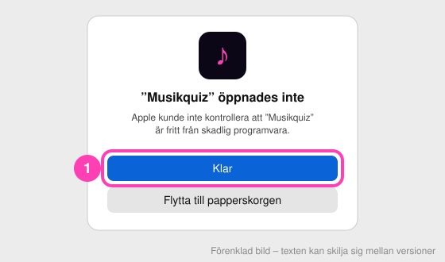
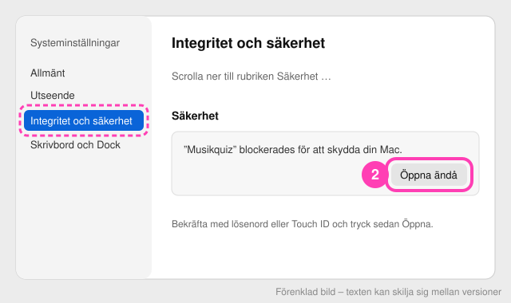
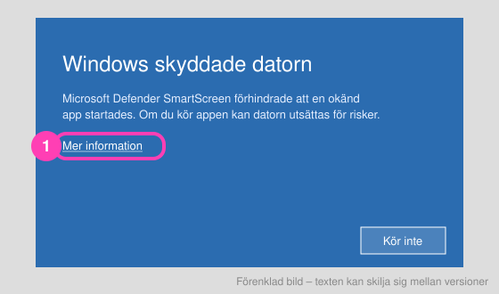
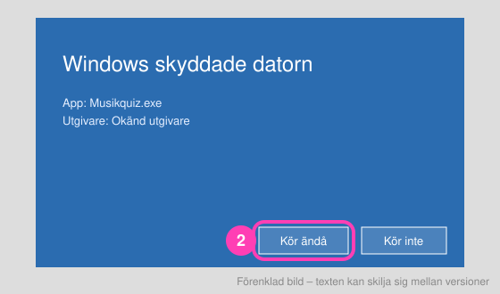

# Installera Musikquiz

Det tar ett par minuter, och bara första gången. Appen är inte signerad hos Apple eller Microsoft, därför varnar datorn. Det är normalt för små gratisappar.

**Ladda ner:** [senaste versionen](https://github.com/AndreasGunnarssonSBF/music-quiz/releases/latest)

| Dator | Fil |
|---|---|
| Mac med Apple-chip (M1 eller senare) | `Musikquiz-mac.zip` |
| Windows 10 eller 11 | `Musikquiz-windows.zip` |

> Osäker på om din Mac har Apple-chip? Klicka på äpplet uppe till vänster → **Om den här datorn**. Står det *Chip Apple M…* är det rätt fil.

---

## Mac

1. Öppna **Hämtade filer** och dubbelklicka på `Musikquiz-mac.zip`. Då packas appen upp.
2. Dra **Musikquiz** till mappen **Program**.
3. Dubbelklicka på Musikquiz. macOS visar en varning. Tryck **Klar**.

   

4. Öppna **Systeminställningar → Integritet och säkerhet**. Scrolla ner till **Säkerhet** och tryck **Öppna ändå** vid Musikquiz. Bekräfta med lösenord eller Touch ID.

   

5. Dubbelklicka på Musikquiz igen och tryck **Öppna**. Webbläsaren öppnas med ditt quizbibliotek.

Nästa gång räcker ett vanligt dubbelklick.

<details>
<summary>För den tekniskt vana: ta bort spärren i Terminal</summary>

```bash
xattr -dr com.apple.quarantine /Applications/Musikquiz.app
```
</details>

---

## Windows

1. Högerklicka på `Musikquiz-windows.zip` och välj **Extrahera alla…**. Lägg mappen till exempel i **Dokument**.
2. Öppna mappen **Musikquiz** och dubbelklicka på **Musikquiz.exe**.
3. Windows visar *Windows skyddade datorn*. Tryck **Mer information**…

   

4. …och sedan **Kör ändå**.

   

5. Webbläsaren öppnas med ditt quizbibliotek.

Tips: högerklicka på **Musikquiz.exe** och välj **Skicka till → Skrivbord (skapa genväg)**, så hittar du appen nästa gång.

> Windows kan fråga om Musikquiz får kommunicera på nätverket. Det behövs bara för **wifi-läget**, så svara gärna **Tillåt** för privata nätverk.

---

## Om något krånglar

| Problem | Lösning |
|---|---|
| Inget händer när jag dubbelklickar | Vänta några sekunder. Webbläsaren öppnas när appen har startat. Kör den redan, så öppnas bara en ny flik. |
| ”Musikquiz är skadat och kan inte öppnas” (Mac) | Zip-filen packades upp av ett annat program. Ladda ner igen och dubbelklicka på zip-filen i Finder. |
| Lagen kommer inte in | Klicka på statusmarkeringen uppe till höger i biblioteket. Slå på **wifi-läget** om internetadressen inte fungerar. Då måste lagen vara på samma wifi som datorn. |
| Jobbdatorn tillåter inte appen | Vissa jobbdatorer är låsta för appar som inte kommer från IT. Använd en privat dator. |

Bilderna i guiden är förenklade. Texten i dialogerna kan skilja sig lite mellan olika versioner av macOS och Windows.
